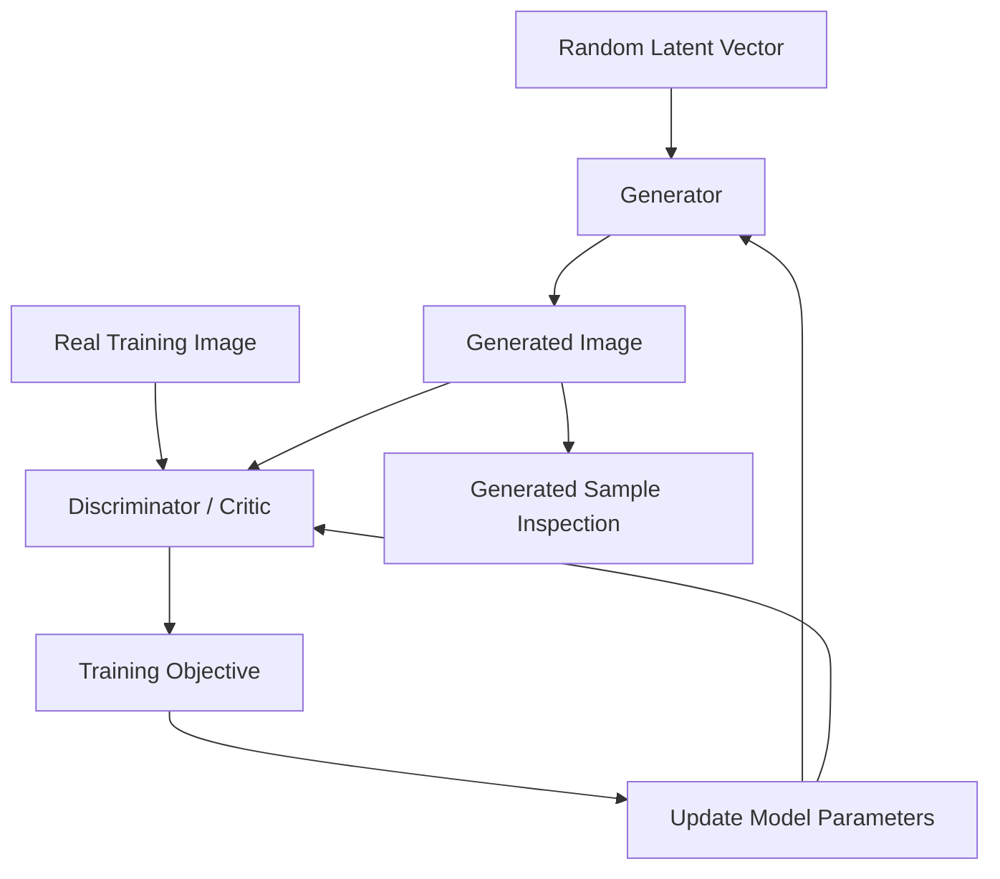

<div align="center">

# Generative Adversarial Networks (GANs)

### A PyTorch Collection for Deep Generative Modeling

Explore and experiment with multiple Generative Adversarial Network architectures using PyTorch and popular image datasets, including MNIST, CIFAR-10, Stanford Cars, and CelebA.

<p>
  
  
  
  
</p>

**Learn · Experiment · Generate · Compare**

</div>

---

## Overview

Generative Adversarial Networks (GANs) are a class of generative models that learn to produce synthetic data resembling examples from a training dataset.

This repository brings together implementations of different GAN architectures using **PyTorch**, providing a hands-on way to understand adversarial training, neural network design, image generation, and the challenges of training generative models.

The collection covers foundational GAN architectures and provides a starting point for experimenting with different datasets, model configurations, and training strategies.

Whether you're learning deep learning or exploring generative modeling, this project aims to make GAN concepts easier to understand through practical implementations.

## Features

- **Multiple GAN Architectures** — Explore Vanilla GAN, DCGAN, Conditional GAN, and Wasserstein GAN.
- **PyTorch Implementations** — Work with neural networks, automatic differentiation, and GPU acceleration.
- **Multiple Image Datasets** — Experiment with handwritten digits, natural images, cars, and facial images.
- **Notebook-Based Learning** — Follow the implementation and training workflow interactively.
- **Configurable Experiments** — Explore hyperparameters such as learning rate, batch size, latent dimension, and training epochs where supported.
- **Image Generation** — Examine how generated samples evolve during training.
- **Comparative Learning** — Understand the differences between GAN architectures and their training objectives.

## GAN Architectures

| Architecture | Full Name | Key Idea |
|---|---|---|
| Vanilla GAN | Generative Adversarial Network | Introduces adversarial training using generator and discriminator networks. |
| DCGAN | Deep Convolutional GAN | Uses convolutional neural networks to model image data. |
| CGAN | Conditional GAN | Conditions generation on additional information, such as a class label. |
| WGAN | Wasserstein GAN | Uses a Wasserstein-distance-based objective to improve the training formulation. |

### 1. Vanilla GAN

The Vanilla GAN is the foundational architecture in this collection. It consists of two competing neural networks.

- **Generator:** Produces synthetic samples from random latent vectors.
- **Discriminator:** Learns to distinguish real training samples from generated samples.

The generator attempts to produce increasingly realistic samples while the discriminator learns to identify generated data.

**What you'll learn:** Adversarial training, latent vectors, loss functions, and the generator–discriminator relationship.

### 2. Deep Convolutional GAN (DCGAN)

DCGAN adapts GAN training to image generation using convolutional layers.

Typical implementations use transposed convolutions in the generator and convolutional layers in the discriminator.

**What you'll learn:** Convolutional neural networks, image feature learning, upsampling, and convolution-based generative models.

### 3. Conditional GAN (CGAN)

A Conditional GAN incorporates additional information into the generation process. For example, a model trained on labeled digits can use a digit label to guide the type of image it generates.

The condition is incorporated into both the generator and discriminator according to the architecture.

**What you'll learn:** Conditional generation, label embeddings or encodings, and controlled image synthesis.

### 4. Wasserstein GAN (WGAN)

WGAN modifies the GAN training objective using a Wasserstein-distance-based formulation.

This approach is designed to provide a more useful training signal in some situations than the original GAN objective. Its behavior depends on the implementation and how the required constraints are enforced.

**What you'll learn:** Alternative GAN objectives, critic networks, and the importance of stable optimization.

> The exact architecture, loss function, and training constraints depend on the implementation in each notebook.

## How GANs Work

A GAN consists of a generator and a discriminator or critic that interact during training.



### Training Workflow

1. Load and preprocess the training dataset.
2. Sample random latent vectors.
3. Generate synthetic images using the generator.
4. Evaluate real and generated samples using the discriminator or critic.
5. Calculate the architecture-specific loss.
6. Update the networks through backpropagation and their optimizers.
7. Repeat for the configured training epochs.
8. Inspect generated samples to observe training progress.

The generator and discriminator objectives differ across GAN variants, so the training loop must follow the requirements of the selected architecture.

## Technology Stack

| Technology | Purpose |
|---|---|
| Python | Core programming language |
| PyTorch | Neural network implementation and training |
| Torchvision | Image datasets, transformations, and utilities |
| NumPy | Numerical computation |
| Matplotlib | Visualization of generated images and training progress |
| Jupyter Notebook | Interactive development and experimentation |
| Google Colab | Optional cloud-based notebook execution with GPU support |

The exact dependencies depend on the notebooks included in the repository.

## Datasets

The collection is intended for experimentation with several image datasets.

| Dataset | Description | Potential Experiments |
|---|---|---|
| MNIST | Grayscale handwritten digit images | Basic GAN training and digit generation |
| CIFAR-10 | Small color images across 10 object categories | Color image generation |
| Stanford Cars | Images of cars across different models and categories | Fine-grained vehicle image generation |
| CelebA | A large collection of celebrity face images with annotations | Face generation and conditional experiments |

Dataset availability, supported architectures, and preprocessing requirements depend on the individual implementation.

### MNIST and CIFAR-10

These datasets can be accessed through `torchvision.datasets` in compatible environments.

For example:

```python
from torchvision import datasets, transforms

transform = transforms.ToTensor()

mnist_dataset = datasets.MNIST(
    root="./data",
    train=True,
    download=True,
    transform=transform
)

cifar10_dataset = datasets.CIFAR10(
    root="./data",
    train=True,
    download=True,
    transform=transform
)
```

The transformation pipeline must match the input range, channel count, and image dimensions expected by the selected GAN.

### Stanford Cars

Stanford Cars contains images of cars organized into fine-grained categories.

Dataset page:

https://ai.stanford.edu/~jkrause/cars/car_dataset.html

Check the dataset's access conditions and license. Additional preprocessing and label preparation may be necessary before training.

### CelebA

CelebA contains face images and associated annotations.

Dataset information:

https://mmlab.ie.cuhk.edu.hk/projects/CelebA.html

Review the dataset's terms of use and the applicable requirements before downloading or using the images.

### Dataset Preparation

Before beginning an experiment:

- Verify that the dataset files are available.
- Apply the image transformations expected by the model.
- Check image dimensions and color channels.
- Normalize pixel values consistently with the generator's output activation.
- Verify label encoding for conditional models.
- Ensure that the selected architecture can process the chosen dataset.

## Getting Started

There are two recommended ways to explore the project: Google Colab or a local Python environment.

### Option 1: Google Colab

Google Colab is a convenient option for running notebooks without configuring a complete local deep-learning environment.

1. Open [Google Colab](https://colab.research.google.com/).
2. Clone or download this repository, or upload the notebook you want to run.
3. Open the relevant `.ipynb` file.
4. Select **Runtime → Change runtime type**.
5. Choose a GPU accelerator if one is available.
6. Install any dependencies missing from the notebook environment.
7. Run the cells sequentially.
8. Inspect the generated images and training outputs.

GPU availability, hardware type, memory, and session duration depend on your Colab plan and current resource allocation.

**Note:** Confirm that the required dataset and model files are accessible from the notebook runtime. Uploaded files may not persist after the session ends.

### Option 2: Run Locally

#### Prerequisites

Install the following:

- Python 3.8 or a compatible newer version
- Git
- pip
- Jupyter Notebook or JupyterLab
- A CUDA-compatible GPU is optional but can accelerate training

The Python version and package versions must also be compatible with the PyTorch release and the specific notebook implementation.

#### Step 1: Clone the Repository

Replace the placeholder repository URL with the actual GitHub URL for this project.

```bash
git clone https://github.com/<YOUR_USERNAME>/<YOUR_REPOSITORY>.git
cd <YOUR_REPOSITORY>
```

#### Step 2: Create a Virtual Environment

**Linux / macOS**

```bash
python3 -m venv .venv
source .venv/bin/activate
```

**Windows PowerShell**

```powershell
python -m venv .venv
.venv\Scripts\Activate.ps1
```

#### Step 3: Install PyTorch

Install a compatible PyTorch and Torchvision combination using the official installation selector:

https://pytorch.org/get-started/locally/

Choose the configuration matching your operating system, Python environment, and CPU or CUDA requirements.

#### Step 4: Install Supporting Packages

```bash
python -m pip install --upgrade pip
python -m pip install jupyter matplotlib numpy pillow tqdm
```

Install any additional dependencies imported by your notebooks.

#### Step 5: Launch Jupyter

```bash
jupyter notebook
```

Open the notebook for the architecture you want to explore and execute the cells in order.

> **Dependency recommendation:** Add a `requirements.txt` file or a suitable environment specification containing the verified project dependencies. This makes future installations and experiments easier to reproduce.

## Running Experiments

The exact notebook names and execution commands depend on the files included in this repository.

For each experiment:

1. Select a GAN architecture.
2. Choose a supported dataset.
3. Configure the model parameters provided by the notebook.
4. Verify dataset paths and image transformations.
5. Run the training cells sequentially.
6. Inspect the generated samples at regular intervals.
7. Save the model checkpoints and outputs if the implementation supports them.

### Important Training Parameters

| Parameter | Description |
|---|---|
| Latent dimension | Size of the random input vector supplied to the generator |
| Batch size | Number of training samples processed in one batch |
| Epochs | Number of complete passes through the training dataset |
| Learning rate | Controls the size of optimizer updates |
| Optimizer | Determines how model parameters are updated |
| Image size | Spatial dimensions expected by the model |
| Number of channels | Number of image channels, such as 1 for grayscale or 3 for RGB |
| Conditional labels | Additional information used by a Conditional GAN |
| Model checkpoint | Saved model parameters used for resuming or evaluating training |

Parameter values should be selected based on the implementation, dataset, and available hardware.

## Generated Results

Visual inspection is an important part of evaluating GAN experiments.

When reviewing generated images, consider:

- **Visual quality:** Do generated samples resemble the training distribution?
- **Diversity:** Does the generator produce varied samples or repeatedly generate similar images?
- **Training stability:** Do generated samples improve, stagnate, or deteriorate as training progresses?
- **Mode collapse:** Does the generator produce only a small range of outputs?
- **Generalization:** Does the model produce useful variation rather than simply memorizing training examples?

Generated images alone do not provide a complete evaluation of model quality. Quantitative measures, such as Fréchet Inception Distance (FID), may be useful when implemented with an appropriate evaluation pipeline and reference dataset.

Do not claim a performance improvement or a specific metric unless it has been measured and documented.

## Project Organization

A possible organizational structure for this collection is:

```text
gan-collection/
├── README.md
├── requirements.txt
│
├── notebooks/
│   ├── VanillaGAN.ipynb
│   ├── DCGAN.ipynb
│   ├── CGAN.ipynb
│   └── WGAN.ipynb
│
├── data/
│   └── Dataset files or download instructions
│
├── outputs/
│   ├── generated_samples/
│   └── training_plots/
│
└── checkpoints/
    └── Saved model weights
```

This is a suggested structure for organizing a GAN project, not a claim about the repository's current directory layout. Keep the documentation synchronized with the actual files in your GitHub repository.

## Best Practices

- Set and document random seeds where reproducibility matters.
- Keep dataset preprocessing consistent with model expectations.
- Monitor generator and discriminator or critic losses together with generated samples.
- Save model checkpoints for long-running experiments.
- Avoid committing large datasets, checkpoints, or generated files unnecessarily.
- Record architecture settings, dataset details, and library versions for each experiment.
- Compare models using consistent data splits and evaluation procedures when appropriate.

## Common Issues

| Issue | Suggested Check |
|---|---|
| CUDA is unavailable | Confirm PyTorch installation and CUDA compatibility, or run on CPU |
| Out-of-memory error | Reduce the batch size or image resolution |
| Dataset download fails | Check network access, permissions, and dataset availability |
| Image dimensions mismatch | Verify dataset transformations and generator output dimensions |
| Loss becomes unstable | Inspect the training objective, learning rates, initialization, and update schedule |
| Generated images lack diversity | Inspect for mode collapse and review training behavior |
| Notebook cannot find a file | Check the working directory and update dataset or checkpoint paths |

GAN training can be sensitive to initialization, hyperparameters, architecture, and data preprocessing. Not every experiment will converge to high-quality outputs.

## Limitations

- Different architectures may require different training strategies and hyperparameters.
- Training on high-resolution or large datasets can require substantial GPU memory and computation.
- GAN training may be unstable and can suffer from mode collapse.
- Results depend on the dataset, implementation, and experimental setup.
- Access to public datasets is subject to the datasets' respective terms and licensing conditions.

## Future Improvements

- [ ] Add verified dependency and environment files.
- [ ] Document the actual notebooks and supported datasets.
- [ ] Add generated sample galleries for each architecture.
- [ ] Save periodic model checkpoints and training visualizations.
- [ ] Add reproducible experiment configurations.
- [ ] Compare GAN architectures under consistent conditions.
- [ ] Add quantitative evaluation using appropriate generative-model metrics.
- [ ] Improve error handling and dataset preparation documentation.
- [ ] Add automated checks for model shapes and training components.
- [ ] Provide clearer explanations of architecture-specific loss functions.

## Contributing

Contributions are welcome, particularly improvements to model implementations, notebook clarity, reproducibility, dataset preparation, and evaluation.

1. Fork the repository.
2. Create a feature branch.
3. Make your changes and test them.
4. Commit your work with a descriptive message.
5. Open a pull request explaining the changes and validation performed.

Please avoid committing downloaded datasets, large generated files, model checkpoints, or files that cannot be redistributed.

## License

No license is specified in this README.

Add a `LICENSE` file describing the permissions and conditions under which the source code may be used, modified, and distributed. Dataset licenses and terms of use must be checked separately.

## Acknowledgements

This project builds on the open-source deep-learning ecosystem, particularly:

- [PyTorch](https://pytorch.org/)
- [Torchvision](https://pytorch.org/vision/stable/index.html)
- [Jupyter](https://jupyter.org/)
- [Google Colab](https://colab.research.google.com/)

Thanks to the researchers and open-source communities whose work has advanced generative modeling and deep learning.

## Author

**Your Name**

- GitHub: [Your GitHub Profile](https://github.com/<YOUR_USERNAME>)
- Repository: [Generative Adversarial Networks Collection](https://github.com/<YOUR_USERNAME>/<YOUR_REPOSITORY>)

---

<div align="center">

**Explore the architectures. Understand the training. Generate new possibilities.**

<sub>Built for deep-learning education and hands-on generative modeling experiments.</sub>

</div>
